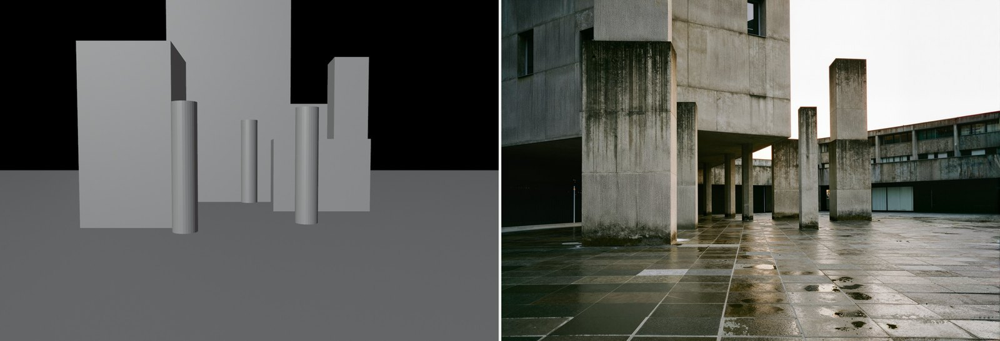
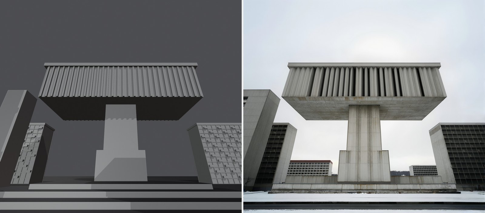

# blender-zimage-6gb

**Turn a gray Blender blockout, or any reference image, into a photoreal 2K image on a 6 GB laptop GPU.**




You block out a scene in Blender with gray boxes, or bring any image (a render, a sketch, a photo). This tool
uses it as a structural guide for **Z-Image-Turbo** in ComfyUI, then adds a 2K detail pass. The image keeps
your composition and geometry, and the prompt decides the materials, light and mood.

```
make_image.bat my_scene.blend --prompt "brutalist concrete housing estate on a foggy winter morning"
```

Built and tested on an **RTX 4050 Laptop GPU (6 GB VRAM)** with 32 GB RAM. One 2K image takes about
**2.3 minutes**, and a 1 MP preview about 35 seconds.

A companion to [blender-wan-6gb](https://github.com/arasarkan/blender-wan-6gb), which does the same for video.

*Türkçe özet aşağıda: [Türkçe](#türkçe)*

## How it works

```
.blend ──► exact depth from Blender ─┐
                                     ├─► Z-Image-Turbo 6B + Fun Union ControlNet ──► 1 MP ──► RealESRGAN ×4 → ½ ──► Z-Image detail pass ──► 2K
image  ──► edges (canny) ────────────┘        (8 steps)                                         (tiled, low denoise)
```

- **From a `.blend`:** depth is rendered straight from your scene geometry. It is exact, not estimated.
- **From an image:** its edges guide the composition. No extra model is needed.
- **2K detail pass:** the image is upscaled, then Z-Image redraws the fine detail at low strength: concrete
  texture, stains, window frames, railings. VAE work is tiled so 2K fits in 6 GB.
- **Only core ComfyUI nodes** are used, so you install no custom nodes.

## Setup (once)

1. Install [ComfyUI](https://www.comfy.org/download) and [Blender](https://www.blender.org/download/)
   (Blender is only needed for `.blend` files).
2. Download this repo: **Code → Download ZIP** and unzip it, or
   `git clone https://github.com/arasarkan/blender-zimage-6gb`
3. Start ComfyUI and wait until it has loaded.
4. Double-click **`setup.bat`**.

The setup uses the Python that comes with ComfyUI, so nothing else needs installing. It:
- finds your ComfyUI install, its Python and its `models` folder, and finds Blender;
- downloads the models that are missing (about 24 GB). It asks first, can resume an interrupted download,
  and checks each file against its SHA256. Files you already have are skipped;
- saves the paths it found to `config.json` and renders a test depth image.

<details>
<summary>Models it downloads (<code>.safetensors</code> only)</summary>

| File | Folder | Size | Source |
|---|---|---|---|
| `z_image_turbo_bf16.safetensors` | `diffusion_models/` | 12.3 GB | [Comfy-Org/z_image_turbo](https://huggingface.co/Comfy-Org/z_image_turbo) |
| `qwen_3_4b.safetensors` | `text_encoders/` | 8.0 GB | [Comfy-Org/z_image_turbo](https://huggingface.co/Comfy-Org/z_image_turbo) |
| `ae.safetensors` | `vae/` | 335 MB | [Comfy-Org/z_image_turbo](https://huggingface.co/Comfy-Org/z_image_turbo) |
| `Z-Image-Turbo-Fun-Controlnet-Union.safetensors` | `model_patches/` | 3.1 GB | [alibaba-pai/Z-Image-Turbo-Fun-Controlnet-Union](https://huggingface.co/alibaba-pai/Z-Image-Turbo-Fun-Controlnet-Union) |
| `RealESRGAN_x4plus.safetensors` | `upscale_models/` | 67 MB | [Comfy-Org/Real-ESRGAN_repackaged](https://huggingface.co/Comfy-Org/Real-ESRGAN_repackaged) |

These are the same files ComfyUI's own "Z-Image-Turbo Fun Union ControlNet" and "Z-Image-Turbo 2K upscaler"
templates use.
</details>

<details>
<summary>Linux / macOS, or if setup.bat can't find ComfyUI</summary>

Run the setup with ComfyUI's own Python, for example:

```
/path/to/ComfyUI/.venv/bin/python setup.py --models-dir /path/to/ComfyUI/models
```

Options: `--server URL`, `--blender PATH`, `--yes`. Then use `python make_image.py ...` with that same Python.
</details>

## Make an image

**Drag a `.blend` file or an image onto `make_image.bat`.** It asks for a prompt and does the rest. Double-click
it without a file to try the example blockout. ComfyUI has to be running.

From a terminal:

```
make_image.bat my_scene.blend --prompt "..." --camera Camera.002 --frame 120 --count 4
make_image.bat sketch.jpg --prompt "..." --aspect 4:5
```

Everything is written to `outputs/<name>/`:

| File | What |
|---|---|
| `image_s<seed>_2k.png` | the final image, about 2.5 MP (for example 2432×1664) |
| `image_s<seed>_1k.png` | the first pass, before the detail pass |
| `compare.jpg` | your input next to the result |
| `control.png` | the depth or edge map that guided it |
| `settings.json` | every setting, so you can reproduce a result |

### Options

| Option | Default | |
|---|---|---|
| `scene.blend` / `image.jpg` | example blockout | what to start from |
| `--prompt` | asked if missing | what the image should look like. English works best |
| `--aspect` | `3:2` for .blend, the image's own shape | `1:1 3:2 2:3 16:9 9:16 4:5 5:4 21:9` |
| `--count` | 1 | variations with seeds `seed, seed+1, …` |
| `--seed` | 42 | |
| `--strength` | 0.8 | how strictly to follow the depth or edges. Lower gives the model more freedom |
| `--control-end` | 1.0 | stop following the control after this fraction of the steps (for example `0.6` for looser details) |
| `--detail` | 0.33 | strength of the 2K detail pass: `0.2` subtle, `0.5` strong |
| `--no-upscale` | | only the 1 MP image (about 35 s instead of 2.3 min). Good for trying prompts |
| `--control` | `depth` for .blend, `canny` for images | |
| `--camera`, `--frame` | scene camera, start frame | which view of the .blend to render |
| `--near`, `--far` | auto | depth range in scene units, mapped to white/black |
| `--control-only` | | only render the depth / edge input, no ComfyUI: a quick check |

## Tips

- **Iterate fast, finish slow:** try prompts with `--no-upscale --count 4`, then rerun the seed you like
  without `--no-upscale`.
- **Silhouettes matter more than detail.** Boxes become buildings, cylinders become columns or towers, the
  ground plane becomes the ground, and empty background becomes sky.
- **If the image ignores your layout,** raise `--strength` to 1.0, or check `control.png` with
  `--control-only`. For `.blend` files, a flat-looking depth means you should set `--near`/`--far`.
- **If the image looks too much like the blockout** (flat walls, boxy shapes), lower `--strength` to 0.6 or
  use `--control-end 0.6`.
- Round shapes sometimes come out square, because depth alone doesn't say "round". Say it in the prompt.

## Performance (RTX 4050 Laptop, 6 GB, 32 GB RAM)

| | Time |
|---|---|
| 1 MP image (`--no-upscale`) | ~35 s |
| 1 MP + 2K detail pass | ~2.3 min |
| First run after starting ComfyUI | +30–60 s to load models from disk |

The 12 GB model does not fit in 6 GB VRAM; ComfyUI streams it from system RAM. 32 GB RAM is recommended.

## Troubleshooting

- **`setup.bat` says ComfyUI is not running:** start ComfyUI and wait until it has fully loaded.
- **ComfyUI crashes during the 2K pass:** close other GPU apps, or use `--no-upscale`.
- **`model ... not found` / `missing core nodes`:** run `setup.bat` again, or update ComfyUI.
- **A download stopped halfway:** run `setup.bat` again and it continues where it stopped.

## License

MIT. See [LICENSE](LICENSE). The models have their own licenses; check each model's page before commercial use.

---

## Türkçe

Blender'da gri kutularla kurduğun bir sahneyi ya da herhangi bir referans görseli (render, çizim, fotoğraf)
**6 GB VRAM'li bir laptopta** 2K fotogerçekçi görsele çevirir. Kompozisyonu ve geometriyi korur; malzemeyi,
ışığı ve atmosferi prompt belirler.

- **Kurulum:** ComfyUI ve Blender'ı kur. ComfyUI açıkken **`setup.bat`**'a çift tıkla. Modelleri (~24 GB)
  kendisi indirir ve her şeyi ayarlar.
- **Görsel:** `.blend` dosyanı ya da bir görseli **`make_image.bat`**'ın üzerine sürükle ve prompt'u yaz.
- **Süre:** 2K görsel ~2,3 dk, hızlı deneme için `--no-upscale` ile ~35 sn.
- **Çıktılar:** `outputs/<isim>/` klasörüne yazılır. `compare.jpg` girdiyle sonucu yan yana gösterir.
